# Motor Cortex Neural Decoding

Predicting a monkey's hand movements from the activity of motor-cortex neurons, using the public **MC_Maze** dataset from the [Neural Latents Benchmark](https://github.com/neurallatents/nlb_tools).

**Status:** All five phases are complete. The best decoder, a recurrent neural network (GRU, built in PyTorch), predicts hand velocity on held-out trials with **R² = 0.75**, compared with 0.61 for ridge regression and 0.40 for a Kalman filter on the same test bins. A timing control confirmed the network's advantage comes from the neural data, not from trial structure. A population-dynamics analysis shows the neurons' collective activity changes about 270 ms before the hand moves, separates by reach direction before movement begins, and rotates during the reach.

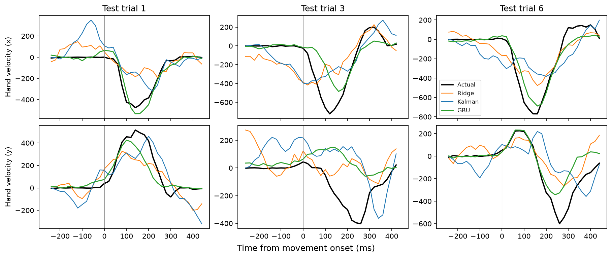

---

## Project goal

Neurons in motor cortex change their firing depending on which way the arm is about to move. A **decoder** is a model that reads the activity of many neurons at once and predicts the movement from it. Brain-computer interfaces use the same idea to let people control a cursor or a robotic arm.

This project builds that pipeline step by step:

1. Load and clean the neural and movement recordings, and line them up in time.
2. Confirm that individual neurons carry information about reach direction.
3. Train decoders that predict **hand velocity** from population activity, starting simple (linear regression) and working up (Kalman filter, recurrent neural network).
4. Describe how the population as a whole is organized: how many dimensions its activity uses, the paths it traces, when it changes relative to the hand, and whether it rotates.

---

## Dataset

| | |
| --- | --- |
| Source | [DANDI Archive, Dandiset 000140](https://dandiarchive.org/dandiset/000140) (MC_Maze_Small, Neural Latents Benchmark) |
| Subject | Monkey "Jenkins" (rhesus macaque) |
| Task | Reaching to targets on a screen after an instructed delay, sometimes around virtual barriers ("maze") |
| Neural data | Spiking activity of **142 neurons** recorded in primary motor cortex (M1) and dorsal premotor cortex (PMd) |
| Behavioral data | Hand position and velocity, cursor position, eye position (x and y for each) |
| Trials used | **100** (the training file, with `split_heldout=False`) |
| Raw resolution | 1 ms (293,666 time points × 150 columns: 142 neurons + 8 behavioral signals) |

The raw data is **not** stored in this repository (`data/` and `*.nwb` are in `.gitignore`). See [Setup](#setup) to download it.

---

## Repository structure

```
motor-cortex-neural-decoding/
├── data/                  # DANDI download goes here (ignored by Git)
├── figures/               # Figures saved by the notebooks
│   ├── 01_single_trial.png
│   ├── 02_hand_paths.png
│   ├── 03_psths.png
│   ├── 04_tuning.png
│   ├── 05_r2_vs_history.png
│   ├── 06_decoded_velocity.png
│   ├── 07_decoded_paths.png
│   ├── 08_kalman_vs_ridge_velocity.png
│   ├── 09_kalman_vs_ridge_paths.png
│   ├── 10_kalman_noise_models.png
│   ├── 11_gru_learning_curves.png
│   ├── 12_decoder_comparison_velocity.png
│   ├── 13_decoder_comparison_r2.png
│   ├── 14_gru_timing_control.png
│   ├── 15_variance_explained.png
│   ├── 16_neural_trajectories.png
│   ├── 17_neural_vs_hand_speed.png
│   ├── 18_decoding_vs_dimensions.png
│   └── 19_jpca_rotations.png
├── notebooks/
│   ├── 01_explore.ipynb         # Phase 1: load, clean, align, explore
│   ├── 02_ridge_decoder.ipynb   # Phase 2: ridge regression decoder
│   ├── 03_kalman_decoder.ipynb  # Phase 3: Kalman filter vs. ridge
│   ├── 03b_kalman_followup.ipynb  # Phase 3b: testing why the Kalman filter scored lower
│   ├── 04_rnn_decoder.ipynb       # Phase 4: GRU decoder vs. ridge and Kalman
│   ├── 04b_gru_timing_control.ipynb  # Phase 4b: timing control for the GRU
│   └── 05_population_dynamics.ipynb  # Phase 5: PCA, trajectories, timing, jPCA
├── src/
│   ├── data.py            # Shared loading, cleaning, and feature-building functions
│   ├── decoders.py        # Ridge baseline and Kalman filter decoder
│   ├── rnn.py             # GRU decoder (PyTorch)
│   └── dynamics.py        # Condition averages, PCA, and jPCA
├── requirements.txt
└── README.md
```

---

## Setup

Tested with Python 3.11 in a conda environment on Windows (VS Code).

**1. Create the environment and install packages**

```bash
conda create -n neurodecode python=3.11 -y
conda activate neurodecode
pip install -r requirements.txt
pip install --no-deps nlb_tools
```

`nlb_tools` was written for older versions of pandas and NumPy, so `requirements.txt` pins `pandas==1.5.3` and `numpy<2`. Installing `nlb_tools` with `--no-deps` stops it from replacing those pinned versions.

`requirements.txt` also includes PyTorch, used in Phase 4. This project only needs the CPU version, which is a much smaller download. To get it, run this before `pip install -r requirements.txt`:

```bash
pip install torch --index-url https://download.pytorch.org/whl/cpu
```

On Windows, import `torch` before other libraries in a notebook. Importing it after them can fail with `WinError 1114` (a known issue in recent PyTorch versions).

**2. Download the data** (run from the repository root)

```bash
cd data
dandi download DANDI:000140
cd ..
```

This creates `data/000140/sub-Jenkins/`, which the notebook reads.

**3. Run the notebooks**

Open the notebooks in `notebooks/` in order in VS Code or Jupyter, select the `neurodecode` kernel, and run all cells. Figures are saved to `figures/`. The cross-validation and training steps in notebooks 02–04b take several minutes each.

---

## Phase 1: what has been done

### 1. Load the data

`nlb_tools.NWBDataset` reads the NWB file and combines spikes and behavior into one pandas table, indexed by time at 1 ms resolution, plus a `trial_info` table with one row per trial (start and end times, movement onset, number of barriers, and so on).

### 2. Fix the time index

The combined time index was not in clean, evenly spaced order. It jumped backward by about 290 seconds at one point and had gaps of 15–25 ms, so pandas could not infer a regular sampling rate and `resample()` failed with `Inferred frequency None ... does not conform to passed frequency`.

**Cause:** `nlb_tools` merges the spike and behavior signals with `pd.concat(..., axis=1)`, and the signals were recorded on slightly different sets of timestamps. In the pandas versions this project uses (newer than the 1.3.4 that `nlb_tools` officially supports), timestamps missing from the first signal are appended at the end of the merged table instead of sorted into place. That produces exactly the backward jump and gaps above.

The fix rounds every timestamp to the nearest millisecond and groups rows by timestamp, which also sorts them:

```python
dataset.data.index = dataset.data.index.round("ms")
dataset.data = dataset.data.groupby(level=0).first()
dataset.data.index.name = "clock_time"
```

Afterward, every step between rows is exactly 1 ms, and no rows were lost (293,666 before and after).

### 3. Bin and smooth the spikes

- **Binning:** spike counts are summed into 20 ms bins (`dataset.resample(20)`). Decoders typically work at this resolution.
- **Smoothing:** a smoothed copy of the spikes (`spikes_smth`) is made with a 40 ms Gaussian kernel (`dataset.smooth_spk(40)`). It is used only for plotting average firing rates.

### 4. Align trials to movement onset

Each trial is cut to a 700 ms window, from 250 ms before to 450 ms after the hand starts moving (`make_trial_data(align_field="move_onset_time", align_range=(-250, 450))`). Lining trials up on the same event lets them be averaged.

### 5. Measure reach direction

For each trial, reach direction is the angle of the hand's net displacement across the window, computed with `np.arctan2(dy, dx)`. Angles are in the 2D plane of the screen: 0° is rightward, 90° is upward, and ±180° is leftward. For plotting, trials are grouped into eight 45° direction bins. Only five of the eight bins contain trials in this dataset (centered at −158°, −22°, 22°, 112°, and 158°).

### 6. Explore with figures

**Figure 1: one trial's spikes** (`figures/01_single_trial.png`)

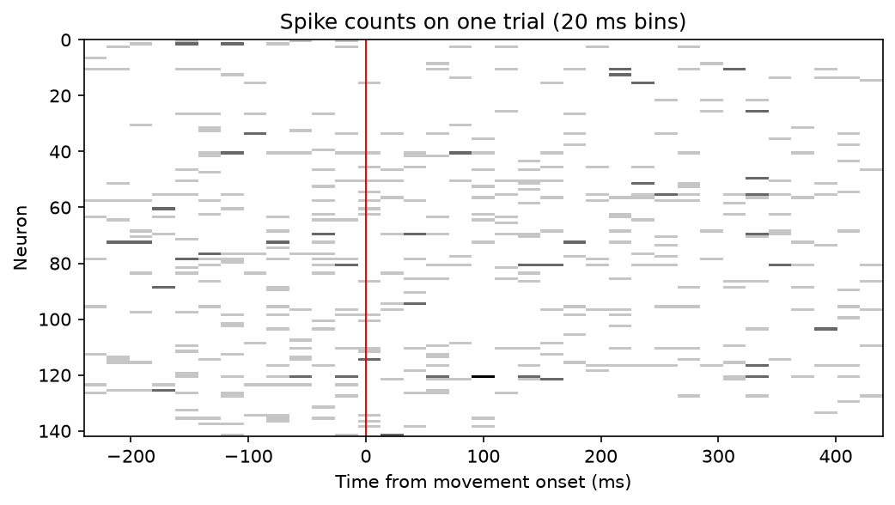

Spike counts for all 142 neurons on a single trial, in 20 ms bins; the red line marks movement onset. Activity is spread thinly across the population, which is why decoders combine many neurons instead of relying on any single one.

**Figure 2: hand paths** (`figures/02_hand_paths.png`)

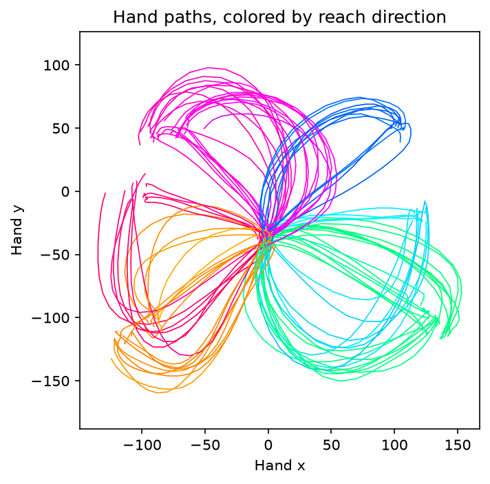

The hand's path on each of the 100 trials, colored by reach direction. Curved paths are reaches around the maze barriers.

**Figure 3: average firing rates by direction (PSTHs)** (`figures/03_psths.png`)

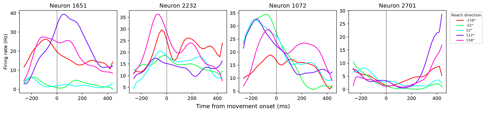

Each panel shows one neuron's average firing rate over time, one line per reach direction (a peri-stimulus time histogram, or PSTH). The four neurons shown are those whose average rate changes most across directions and time (largest modulation depth). For example, neuron 1651 peaks near 39 Hz shortly after movement onset for 112° reaches but stays below about 7 Hz for ±22° reaches. Neurons 2232 and 1072 reach their peak before the hand starts moving.

**Figure 4: directional tuning** (`figures/04_tuning.png`)

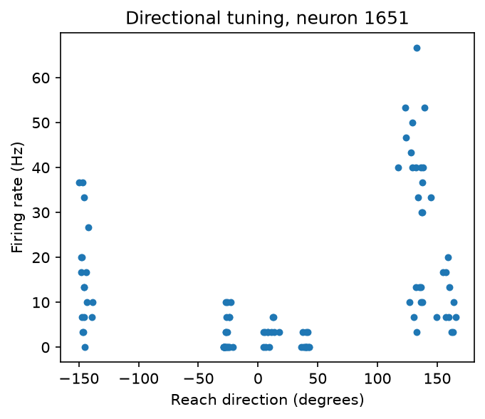

Neuron 1651's average firing rate during the first 300 ms of movement on each trial, plotted against reach direction. It fires at roughly 30–67 Hz on many reaches near 120–140° and at 0–10 Hz on reaches between −30° and 45°. This **directional tuning** is the signal a decoder learns to read.

---

## Phase 2: ridge regression decoder

Notebook: `notebooks/02_ridge_decoder.ipynb`. Shared code: `src/data.py`.

### Method

- **Window:** 250 ms before to 450 ms after movement onset, the window the Neural Latents Benchmark uses to score velocity decoding.
- **Inputs:** spike counts of all 142 neurons in each 20 ms bin, plus counts from up to 10 earlier bins (200 ms of spike history). Only past bins are used, as a real-time decoder would require.
- **Target:** hand velocity (x and y) in the same bin.
- **Split:** 80 training trials and 20 held-out test trials, split by whole trial so neighboring bins can't leak between training and testing.
- **Model:** `StandardScaler` + `Ridge` (scikit-learn). The penalty strength (alpha) is chosen by 5-fold cross-validation grouped by trial (`GroupKFold`), on training trials only.
- **Fair comparison:** the feature table is built once with the full 200 ms of history, so every history length is trained and tested on exactly the same bins. The history length is chosen by cross-validated R², not by the test score.

### Results

| Spike history (ms) | Best alpha | Cross-validated R² | Test R² (x) | Test R² (y) | Test R² (mean) |
| --- | --- | --- | --- | --- | --- |
| 0 | 1,000 | 0.136 | 0.179 | 0.086 | 0.133 |
| 20 | 1,000 | 0.223 | 0.260 | 0.149 | 0.204 |
| 40 | 1,000 | 0.287 | 0.307 | 0.189 | 0.248 |
| 60 | 1,000 | 0.336 | 0.344 | 0.211 | 0.277 |
| 80 | 1,000 | 0.379 | 0.384 | 0.237 | 0.310 |
| 100 | 1,000 | 0.413 | 0.414 | 0.258 | 0.336 |
| 140 | 3,162 | 0.482 | 0.503 | 0.347 | 0.425 |
| **200** | **3,162** | **0.574** | **0.585** | **0.424** | **0.505** |

**Result:** with 200 ms of spike history, the decoder explains about half the variance in hand velocity on trials it never saw (R² = 0.50; x = 0.59, y = 0.42). Without history, R² is only 0.13.

**Figure 5: accuracy vs. spike history** (`figures/05_r2_vs_history.png`)

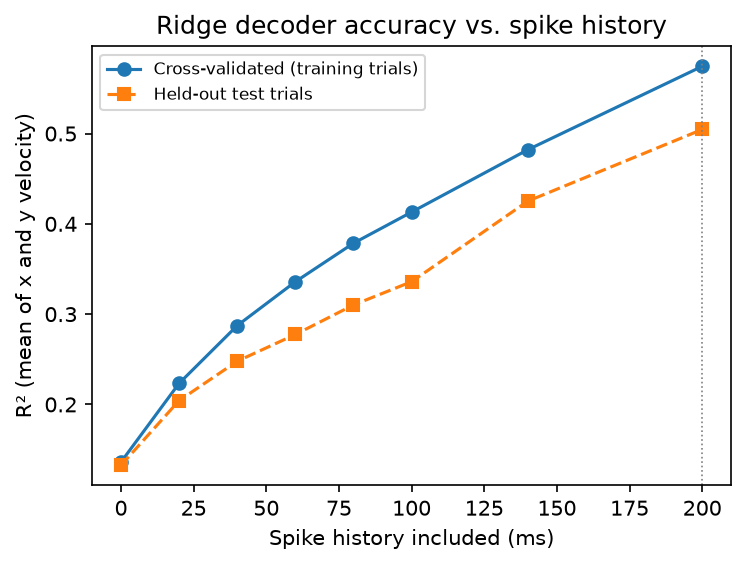

Accuracy rises steadily with history and had not leveled off at 200 ms, the longest history tried. Two things likely drive this: motor cortex activity leads movement, and adding up spikes over more bins averages out spike-count noise. Test R² runs a little below cross-validated R²; with only 20 test trials, the test score itself carries real uncertainty.

**Figure 6: decoded vs. actual velocity** (`figures/06_decoded_velocity.png`)

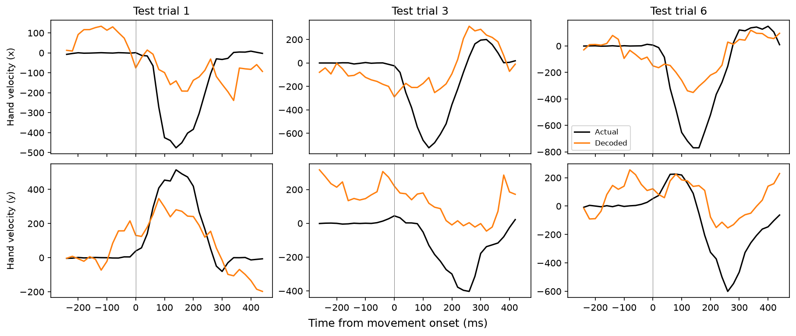

On several test trials the decoded velocity follows the timing and shape of the real movement, but its peaks are too small. Ridge regression pulls predictions toward the average, which shrinks large values. The decoder also predicts some movement before the hand starts moving.

**Figure 7: reach paths rebuilt from velocity** (`figures/07_decoded_paths.png`)

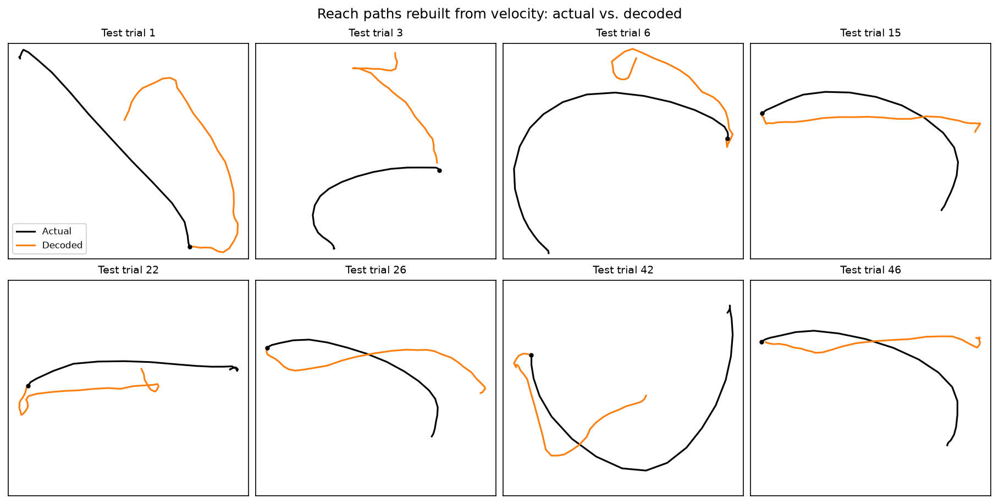

Adding up velocity over time turns small errors into drift. Several decoded paths head roughly the right way but miss the curves around barriers, and some go the wrong way. This is the problem Kalman filters, and the user's own visual feedback in a real brain-computer interface, help correct.

**For context:** on the full MC_Maze dataset, which has far more training trials, the Neural Latents Benchmark paper reports R² = 0.62 for its simplest baseline (smoothed spikes into ridge regression) and up to 0.91 for deep latent-variable models ([Pei et al., 2021](https://arxiv.org/abs/2109.04463), Table 1). Those numbers use a different setup and dataset size, so they are a rough reference, not a direct comparison.

---

## Phase 3: Kalman filter decoder vs. ridge

Notebook: `notebooks/03_kalman_decoder.ipynb`. Shared code: `src/decoders.py`, `src/data.py`.

### Method

- **Same test set:** the same 80 training and 20 held-out test trials as Phase 2 (same random seed).
- **Kalman filter:** the state is hand position, velocity, and a constant. A movement model (how the state changes each 20 ms step) and a neural model (what spike counts each state produces) are both fit by least squares on training trials. At each step the filter predicts the next state from the movement model, then corrects it with the new spikes.
- **Kalman settings:** the neural **lag** (0–160 ms) and the **spike window** summed per step (20–140 ms) were chosen by 5-fold cross-validation on the training trials. The best setting was a 160 ms lag and a 60 ms window.
- **Ridge, revisited:** Phase 2's ridge decoder was still improving at 200 ms of history, so 300 and 400 ms were also tried, choosing by cross-validated R². 400 ms scored best.
- **Fair comparison:** both decoders were scored on the same 700 test bins.

### Results

| Decoder | Test R² (x) | Test R² (y) | Test R² (mean) |
| --- | --- | --- | --- |
| **Ridge, 400 ms of spike history** | **0.686** | **0.525** | **0.606** |
| Kalman filter, 160 ms lag, 60 ms window | 0.506 | 0.294 | 0.400 |

**Result:** ridge with 400 ms of history is the best decoder so far (R² = 0.61, up from 0.50 with 200 ms). The Kalman filter scored 0.40 on the same bins.

**Figure 8: decoded velocity, ridge and Kalman** (`figures/08_kalman_vs_ridge_velocity.png`)

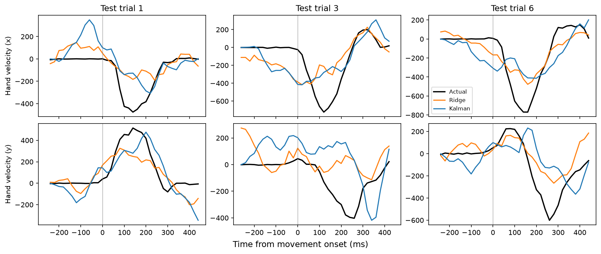

Both decoders follow the broad timing of the movement and both undershoot the peaks. Before movement onset, the Kalman filter often reports large velocities while the hand is still.

**Figure 9: reach paths rebuilt from velocity** (`figures/09_kalman_vs_ridge_paths.png`)

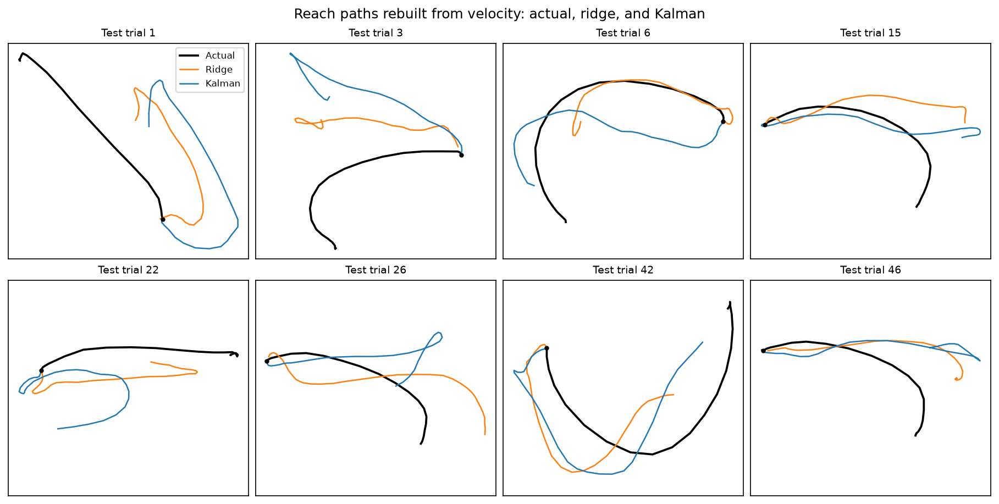

Neither decoder reproduces the curved reaches well; both drift as errors accumulate.

### Why the Kalman filter likely underperformed

These were the leading hypotheses. Phase 3b (below) tested the first and the last:

- **Too many parameters for the data.** The neural noise model has about 10,000 entries (142 × 142 neurons), estimated from roughly 2,800 training bins with no tuned regularization. Ridge's penalty, by contrast, is tuned by cross-validation.
- **A movement model too simple for reaches.** A linear "next state ≈ A × current state" rule can't represent a reach's rise and fall in speed. Ridge sidesteps this by reading 400 ms of spiking directly.
- **Planning activity read as movement.** Motor cortex is strongly active while a reach is being prepared, in patterns that don't move the arm ([Kaufman et al., 2014](https://doi.org/10.1038/nn.3643)). The Kalman filter's neural model sees one short spike window at a time, which may explain its spurious velocities before movement.
- **Lag at the edge of the range tried.** The chosen 160 ms lag was the longest tested.

Kalman filters have done well in closed-loop brain-computer interfaces, where users see the cursor and correct errors as they happen. An offline test like this one can't capture that.

**Note on the 400 ms history:** for the earliest bins in the window, 400 ms of history reaches back into the planning period before the reach. That's still past activity, available in real time, but it means the decoder draws on planning-related as well as movement-related signals.

### Follow-up (Phase 3b): testing two explanations

Notebook: `notebooks/03b_kalman_followup.ipynb`.

Three versions of the Kalman filter's neural noise model were compared, each with its lag (0–280 ms) and spike window (20–140 ms) chosen by 5-fold cross-validation on the training trials:

- **Full:** the original, with every neuron pair's covariance (about 10,000 numbers).
- **Diagonal:** each neuron's own variance only (142 numbers), treating neurons as independent.
- **Shrinkage:** the full estimate pulled toward a simpler one (Ledoit-Wolf), by an amount chosen from the data.

| Decoder | Lag (ms) | Window (ms) | Cross-validated R² | Test R² (x) | Test R² (y) | Test R² (mean) |
| --- | --- | --- | --- | --- | --- | --- |
| Kalman, full noise (original) | 160 | 60 | 0.457 | 0.506 | 0.294 | 0.400 |
| Kalman, diagonal noise | 160 | 60 | 0.431 | 0.500 | 0.145 | 0.323 |
| Kalman, shrinkage noise | 160 | 60 | 0.467 | 0.508 | 0.301 | 0.405 |
| **Ridge, 400 ms history (Phase 3)** | | | | **0.686** | **0.525** | **0.606** |

All rows are scored on the same 700 test bins.

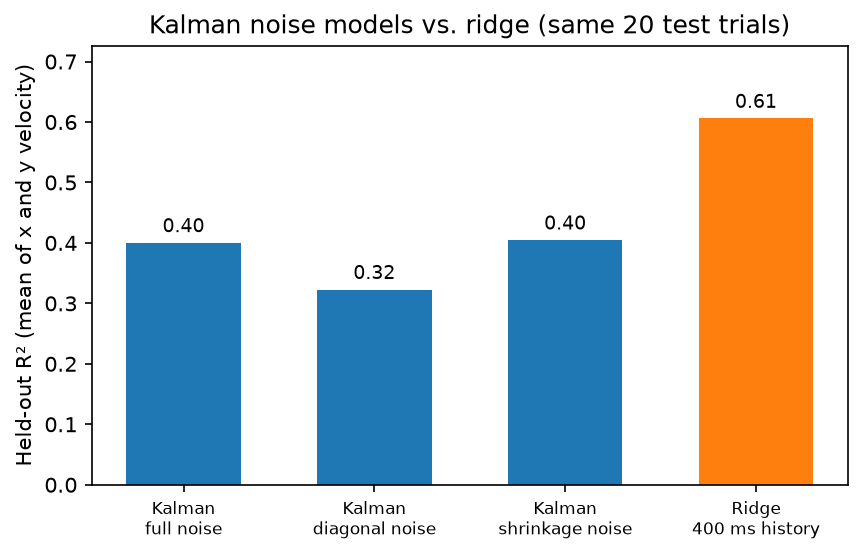

**Findings:**

- **Too many parameters: not supported.** Shrinkage matched the original (0.405 vs. 0.400), and the diagonal model did worse (0.323), mostly in y velocity (0.145 vs. 0.294). Overfitting the noise model is not what holds the Kalman filter back. The correlations between neurons that the full model captures actually help, likely by letting the filter discount fluctuations shared across many neurons.
- **Lag at the edge: settled.** With lags up to 280 ms, all three versions still chose 160 ms, and cross-validated R² fell at longer lags. 160 ms is a genuine best, not an artifact of the range.
- **What remains:** the Kalman filter's simple linear movement model and its short spike window (60 ms, versus ridge's 400 ms of history), along with the possibility that it reads planning activity as movement. A recurrent neural network (Phase 4) can learn its own movement dynamics from long spike histories, which tests these directly.

---

## Phase 4: recurrent neural network (GRU) decoder

Notebook: `notebooks/04_rnn_decoder.ipynb`. Shared code: `src/rnn.py`, `src/data.py`.

### Method

- **Network:** a GRU reads all 142 neurons' spike counts one 20 ms bin at a time, starting 400 ms before the decoding window, and outputs hand velocity at every bin. It only looks backward in time, as a real-time decoder must. A linear readout maps its hidden state to velocity.
- **Inputs and targets:** spike counts and velocity are standardized (mean 0, standard deviation 1) using training trials only.
- **Splits:** the same 20 test trials as every earlier phase. 16 of the 80 training trials were held back as a validation set for choosing settings.
- **Tuning:** 32, 64, or 128 hidden units, each with and without dropout (0.3), trained with the AdamW optimizer and early stopping on validation error.
- **Final model:** the chosen network was retrained on all 80 training trials five times with different random seeds. The five networks' predictions were averaged (an ensemble).
- **Comparison:** ridge (400 ms of history) and the Kalman filter (shrinkage noise model, 160 ms lag) were refit with their best settings and scored on the same 700 test bins.

### Tuning (validation set)

| Hidden units | Dropout | Best epoch | Validation R² (x) | Validation R² (y) | Validation R² (mean) |
| --- | --- | --- | --- | --- | --- |
| 32 | 0 | 24 | 0.422 | 0.300 | 0.361 |
| 32 | 0.3 | 459 | 0.840 | 0.837 | 0.839 |
| 64 | 0 | 56 | 0.631 | 0.416 | 0.524 |
| 64 | 0.3 | 173 | 0.837 | 0.785 | 0.811 |
| 128 | 0 | 44 | 0.653 | 0.577 | 0.615 |
| **128** | **0.3** | **146** | **0.880** | **0.843** | **0.861** |

### Results (same 700 test bins)

| Decoder | Test R² (x) | Test R² (y) | Test R² (mean) |
| --- | --- | --- | --- |
| **GRU, 128 units, 5-network ensemble** | **0.845** | **0.674** | **0.759** |
| Ridge, 400 ms history | 0.686 | 0.525 | 0.606 |
| Kalman filter, shrinkage noise, 160 ms lag | 0.508 | 0.301 | 0.405 |

Single GRU networks scored 0.730 ± 0.012 (mean ± SD over 5 seeds; range 0.709–0.737), so every one of them beat ridge.

**Figure 11: learning curves** (`figures/11_gru_learning_curves.png`)

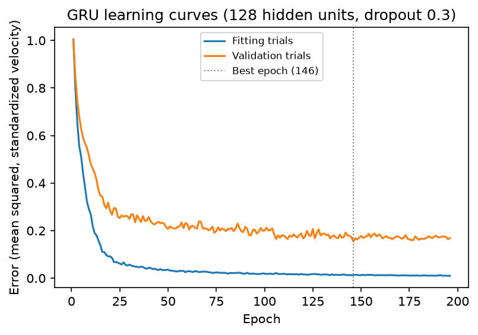

Error on the fitting trials falls almost to zero while validation error levels off around 0.17. The network has enough capacity to memorize the training trials, so dropout and early stopping were essential: without dropout, validation R² was only 0.36–0.62.

**Figure 12: decoded velocity, all three decoders** (`figures/12_decoder_comparison_velocity.png`, shown at the top of this page)

The GRU stays near zero before the hand starts moving, where ridge and especially the Kalman filter report spurious movement, and it gets closer to the true peaks. All three decoders miss some movements, such as the large y velocity in test trial 3, and y velocity remains harder to decode than x.

**Figure 13: R² by decoder** (`figures/13_decoder_comparison_r2.png`)

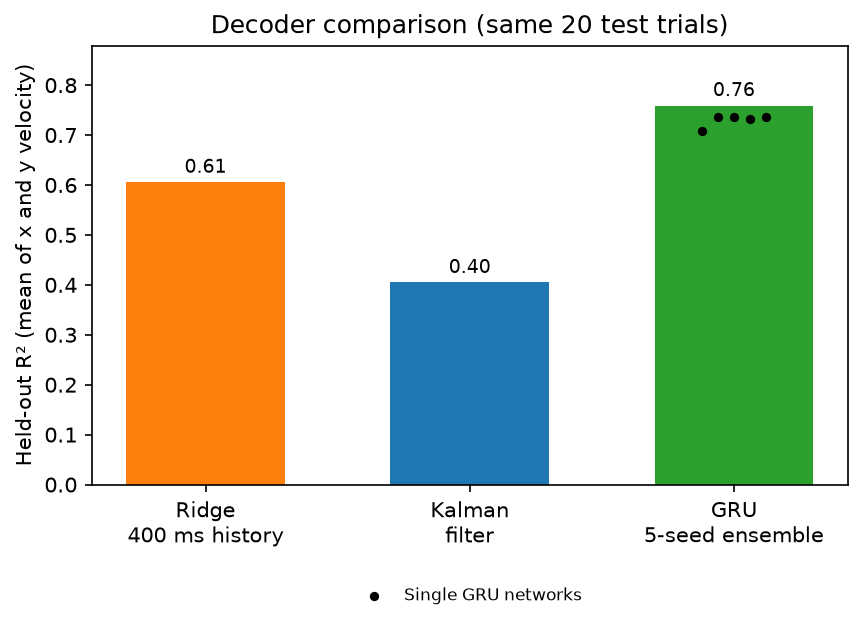

**Interpretation:** the GRU's advantage is consistent with the Phase 3b conclusion that linear movement dynamics and short spike windows were limiting. A network that learns its own, nonlinear dynamics from long spike histories decodes better. Validation R² (0.86) was higher than test R² (0.73 per network) because the validation trials were used to choose settings and number only 16. The test score is the unbiased estimate.

### Timing control (Phase 4b)

Notebook: `notebooks/04b_gru_timing_control.ipynb`.

**Concern:** every GRU input sequence started exactly 650 ms before movement onset. A recurrent network could learn *when* movement begins from its position in the sequence instead of from the neurons, information a real brain-computer interface wouldn't have. Ridge can't use this shortcut, because its inputs are spike counts only.

**Test:** each sequence was given a random start (400–800 ms of history before the window), drawn separately for every trial. Each training trial was included three times with different random starts. The network was then retrained, with early stopping, and tested on the same 700 bins.

| GRU version | Test R² (x) | Test R² (y) | Test R² (mean) | Single networks (mean ± SD) |
| --- | --- | --- | --- | --- |
| Fixed start (Phase 4) | 0.845 | 0.674 | 0.759 | 0.730 ± 0.012 |
| **Random start (control)** | **0.828** | **0.669** | **0.748** | **0.717 ± 0.021** |

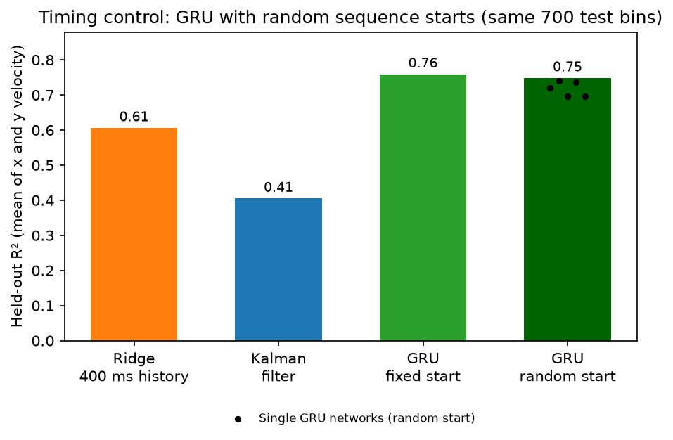

**Result:** R² changed by only −0.01, less than the spread between individual networks. The GRU was not relying on sequence timing, and its advantage over ridge (0.61) holds. The controlled value, **R² = 0.75**, is the conservative figure to report.

### Limitations

- One monkey, one session, and 100 trials. The results may not carry over to other animals, sessions, or larger datasets.
- Offline decoding only. A real brain-computer interface runs in closed loop, where the user sees the output and corrects it, and that can change which decoder works best.
- The 32-unit network with dropout trained until near the 500-epoch limit (best epoch 459), so with more epochs it might have scored slightly higher.

---

## Phase 5: population dynamics

Notebook: `notebooks/05_population_dynamics.ipynb`. Shared code: `src/dynamics.py`.

Phases 2–4 asked how well the neurons predict the hand. This phase asks how the population as a whole is organized.

### Method

- **Condition averages:** trials were grouped into the same five reach-direction bins as Phase 1 (16–30 trials each). Each neuron's firing rate was smoothed with a 20 ms Gaussian kernel and averaged within each bin, from 400 ms before to 500 ms after movement onset.
- **Soft normalization:** each neuron was divided by its range of average rates plus 5 Hz, so a few high-firing neurons don't dominate.
- **PCA** on the condition-averaged activity of all 142 neurons.
- **Timing:** "neural speed" (how fast the population state moves through the top 10 PCs) was compared with hand speed, using the time each first reaches half its peak.
- **Decoding from a few dimensions:** the 400 ms ridge decoder from Phase 3 was refit on only the top *k* PCs of the spike counts. The PCs were computed from training trials only and scored on the same 700 test bins.
- **jPCA**, following [Churchland et al. (2012)](https://www.nature.com/articles/nature11129): from 60 ms before to 200 ms after movement onset, after removing the across-condition average and reducing to the top 6 PCs. The population's bin-to-bin change was fit with a pure-rotation model and with unconstrained linear dynamics.

### Results

| Measure | Result |
| --- | --- |
| Variance captured by PC1–3 | 37% |
| PCs needed for 90% of the variance | 37 of 142 |
| Population lead over the hand (half-peak speed) | about 270 ms |
| Decoding R² from the top 10 PCs / top 40 PCs / all 142 neurons | 0.42 / 0.52 / 0.61 |
| jPCA fit of bin-to-bin change: rotation only vs. any linear dynamics | R² = 0.32 vs. 0.38 (rotation captures 85%) |
| jPC plane's share of the top-6-PC variance | 27% |
| Rotation frequency | about 1.5 cycles per second |

**Figure 15: variance explained** (`figures/15_variance_explained.png`)

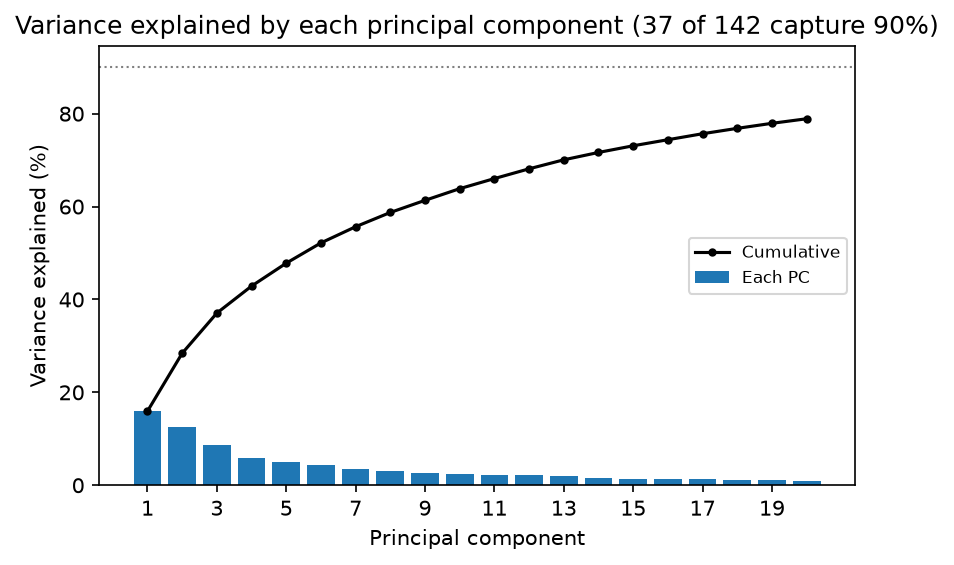

Variance is spread gradually: the top 3 PCs capture 37%, the top 10 nearly two-thirds, and 37 PCs are needed for 90%. With only 16–30 trials per condition, averaging leaves noise spread across many dimensions, so the 90% figure likely overstates how many dimensions the structured activity really uses.

**Figure 16: neural trajectories** (`figures/16_neural_trajectories.png`)

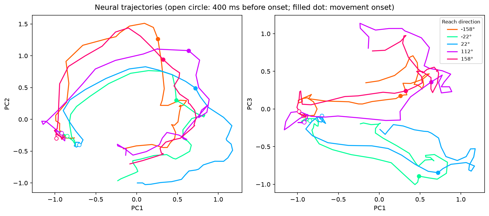

All five reach directions start from nearly the same state. In PC1 and PC2 they then travel a similar large arc, so the biggest components mostly reflect activity *shared* by every reach. That is consistent with reports that the largest response component in motor cortex reflects movement timing rather than movement type ([Kaufman et al., 2016](https://www.eneuro.org/content/3/4/ENEURO.0085-16.2016)). PC3 separates rightward reaches (−22°, 22°) from leftward and upward ones (112°, 158°, −158°), and that separation is already visible at movement onset: the population "commits" to a direction before the hand moves.

**Figure 17: population activity leads the hand** (`figures/17_neural_vs_hand_speed.png`)

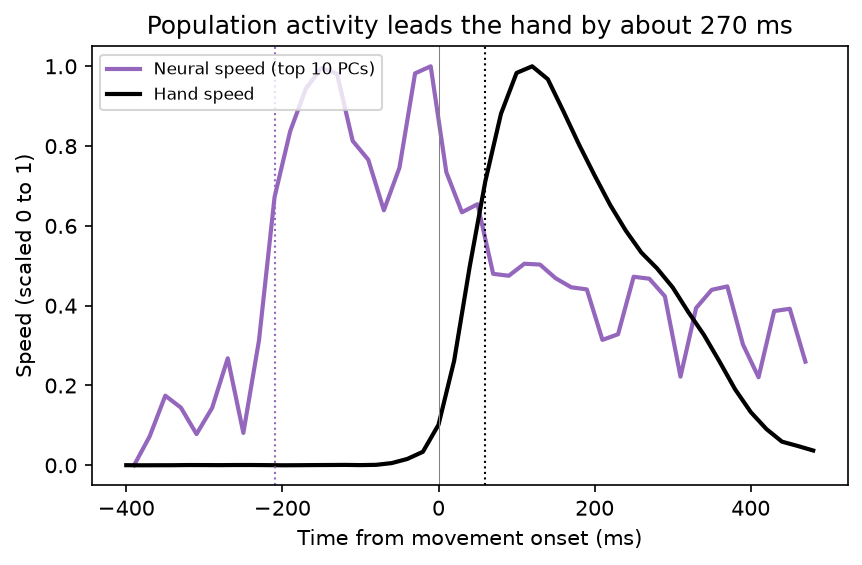

Neural speed reaches half its peak about 210 ms *before* movement onset; hand speed reaches half its peak about 60 ms after, a lead of about 270 ms. Part of the early change likely reflects the transition from preparing to moving after the go cue. This lead explains why the decoders benefited from long spike histories (400 ms for ridge) and why the Kalman filter chose a 160 ms lag.

**Figure 18: decoding from a few dimensions** (`figures/18_decoding_vs_dimensions.png`)

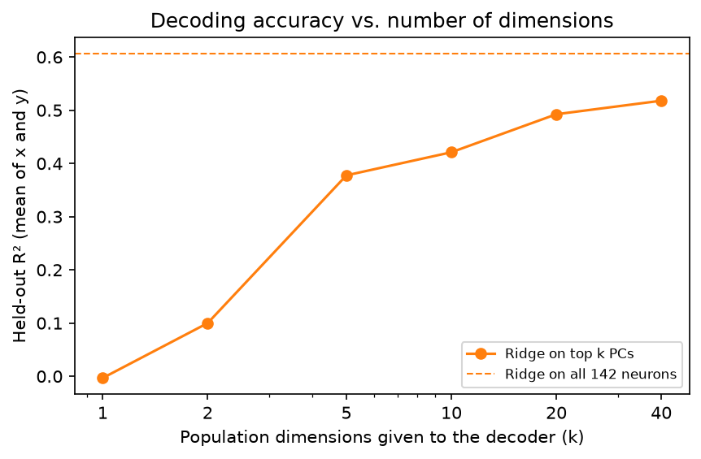

| Dimensions (k) | 1 | 2 | 5 | 10 | 20 | 40 | All 142 neurons |
| --- | --- | --- | --- | --- | --- | --- | --- |
| Test R² (mean) | 0.00 | 0.10 | 0.38 | 0.42 | 0.49 | 0.52 | 0.61 |

The top few dimensions carry little velocity information: 10 PCs recover about 70% of the full decoder's accuracy, and 40 recover about 85%. The highest-variance patterns are not the velocity patterns, which fits Figure 16: the largest components mostly reflect shared, timing-related activity, while direction-specific information sits in smaller ones.

**Figure 19: rotational dynamics (jPCA)** (`figures/19_jpca_rotations.png`)

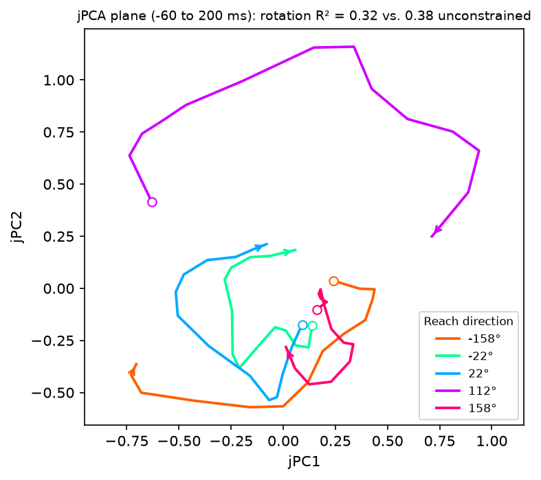

In the jPC plane, the trajectories mostly circle in the same direction (clockwise in this view), the signature jPCA looks for. A pure-rotation model captures 85% of what unconstrained linear dynamics capture, and the plane holds 27% of the top-6-PC variance, so the rotation sits in meaningful dimensions rather than noise. This is consistent with Churchland et al. (2012), but with only five conditions it is a rough estimate, and what such rotations mean has been debated ([Lebedev et al., 2019](https://www.ncbi.nlm.nih.gov/pmc/articles/PMC6908571/)).

### Limitations

- Only five reach-direction conditions, far fewer than the original jPCA study, and 16–30 trials per condition.
- Smoothing is centered in time, so the lead estimate is approximate to within a few tens of milliseconds, and the half-peak definition affects the exact number.
- Neural speed includes changes shared by all reaches, such as the response to the go cue, not just movement-specific activity.

### How the phases fit together

The population starts changing well before the hand, and much of its largest activity is shared across reaches rather than specific to direction. That explains three earlier findings: spike history helped every decoder, the Kalman filter mistook pre-movement activity for movement, and the GRU, which learns its own dynamics from long histories, decoded best.

---

## Key terms

- **Spike count / binning:** the number of times a neuron fires within a time window (here, 20 ms).
- **Firing rate (Hz):** spikes per second, computed as the spike count divided by the window length.
- **PSTH:** a neuron's firing rate over time, averaged across trials aligned to the same event.
- **Modulation depth:** how much a neuron's average firing rate varies across conditions and time (maximum minus minimum).
- **Directional tuning:** a neuron firing more for some movement directions than others.
- **Decoder:** a model that predicts behavior (here, hand velocity) from neural activity.
- **Ridge regression:** linear regression with a penalty (alpha) that shrinks weights toward zero, which keeps the model from fitting noise when there are many correlated inputs.
- **Cross-validation:** repeatedly training on part of the training data and scoring on the rest, to choose settings without touching the test set.
- **R²:** the share of the variation in the true values that the predictions explain (1 = perfect, 0 = no better than always predicting the average).
- **Kalman filter:** a decoder that keeps a running estimate of the hand's state, predicting each next step from a movement model and correcting it with the new spikes.
- **Recurrent neural network (GRU):** a neural network that reads a sequence one step at a time and carries a memory (hidden state) forward, so each output can depend on everything before it. A GRU (gated recurrent unit) is a common, compact type.
- **Validation set:** training trials held back to choose settings and decide when to stop training, so the test trials stay untouched until the end.
- **Dropout and early stopping:** two guards against overfitting. Dropout randomly silences inputs during training; early stopping halts training once validation error stops improving.
- **Ensemble:** averaging the predictions of several separately trained networks, which usually beats any single one.
- **PCA (principal component analysis):** finds the directions in the 142-neuron space along which activity varies most. Each principal component is a weighted mix of neurons.
- **Neural trajectory:** the path the population's activity traces through the top principal components over time.
- **Condition average:** a neuron's firing rate averaged over all trials of the same type (here, reach-direction bin).
- **jPCA:** a method that looks for a plane in which the population state rotates, by fitting its bin-to-bin change with a pure-rotation model.

---

## Roadmap

- [x] **Phase 1:** load, clean, align, and explore the data (Sep 2026)
- [x] **Phase 2:** ridge regression baseline predicting hand velocity from binned spikes, scored with R² on held-out trials (Oct 2026; R² = 0.50)
- [x] **Phase 3:** Kalman filter decoder, compared with ridge on identical test bins; ridge with 400 ms of history scored best (Oct 2026; R² = 0.61 vs. 0.40)
- [x] **Phase 3b:** tested two explanations for the Kalman filter's lower score; a simpler noise model did not help, and the best lag stayed at 160 ms across 0–280 ms (Oct 2026)
- [x] **Phase 4:** recurrent neural network (GRU) decoder; best of the three decoders (Oct 2026; R² = 0.76 vs. 0.61 ridge and 0.40 Kalman)
- [x] **Phase 4b:** timing control; the GRU's advantage held with randomized sequence starts (R² = 0.75)
- [x] **Phase 5:** population dynamics: dimensionality, neural trajectories, neural vs. hand timing, decoding from top dimensions, and jPCA (Oct 2026)
- [ ] **Future direction:** decode behavior from mouse Neuropixels recordings, using pose-tracking (SLEAP) and behavior-segmentation (Keypoint MoSeq) outputs
- [ ] **Future direction:** rerun the decoders on the larger MC_Maze datasets to test whether the GRU's advantage grows with more training data

---

## Data and tools

- Data: [DANDI Archive, Dandiset 000140](https://dandiarchive.org/dandiset/000140). See the Dandiset page for the original data citation.
- Benchmark and loading code: [Neural Latents Benchmark, `nlb_tools`](https://github.com/neurallatents/nlb_tools); Pei et al. (2021), *Neural Latents Benchmark '21*, [arXiv:2109.04463](https://arxiv.org/abs/2109.04463).
- Python libraries: pandas, NumPy, matplotlib, scikit-learn, PyTorch, pynwb, dandi.

---

## Author

**James Abednego Delinois** · [LinkedIn](https://www.linkedin.com/in/james-delinois-619a481b7) · [GitHub](https://github.com/jamesdelinois)
